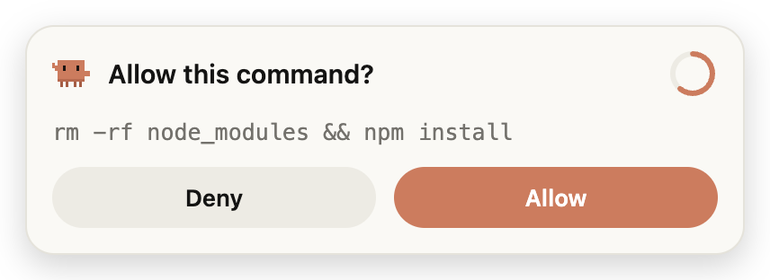
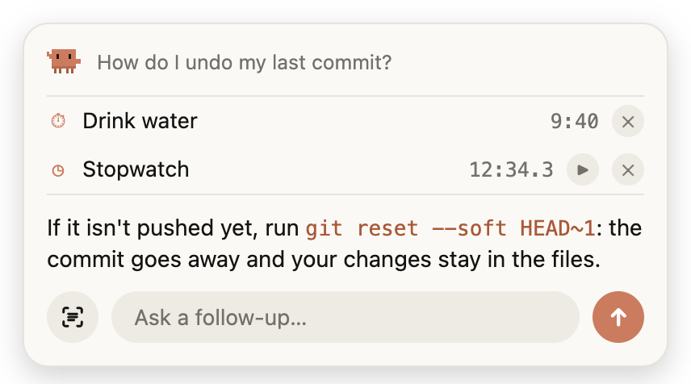
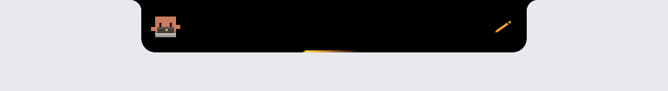
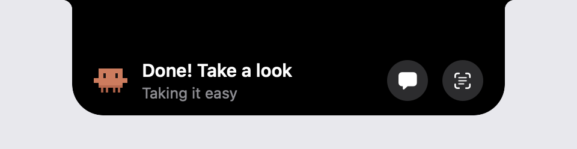
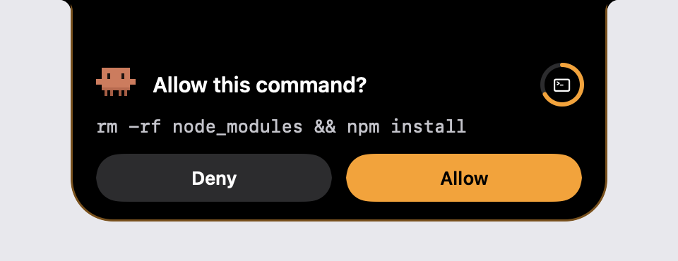
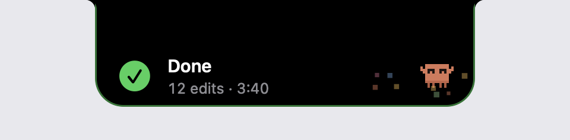
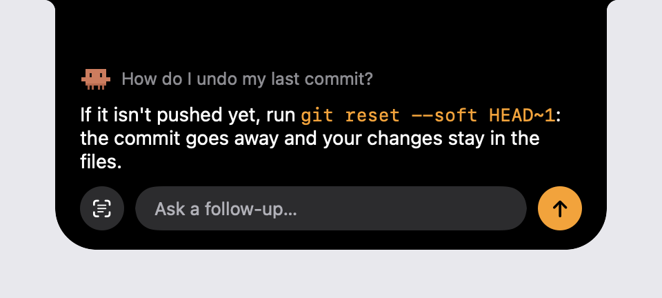
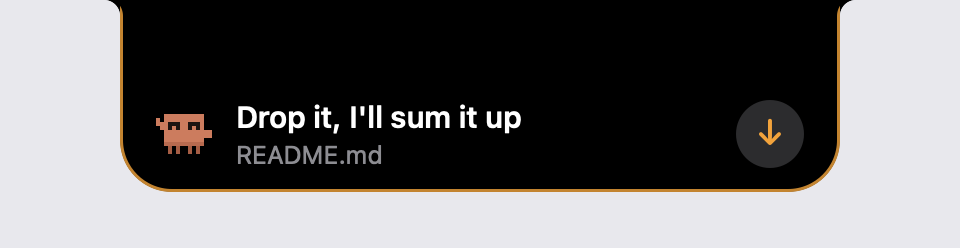

<p align="center"></p>

<h1 align="center">Clawd Buddy</h1>

<p align="center">A tiny pixel crab that lives in the corner of your screen and reacts to what Claude Code is doing.<br>For macOS and Windows. It can also approve Claude's requests, chat, read a file you drop on it, look at your screen and keep timers: on Windows in a card next to the crab, on a Mac also inside the notch (<a href="#notch-mode-macos-only">the notch is macOS only</a>).</p>

<p align="center">
  
  
</p>

> Unofficial fan project. Not affiliated with Anthropic.

## What it does

| Claude Code | Clawd |
|---|---|
| You send a prompt | hops, thinks with `?` bubbles |
| Edit / Write | types on a little laptop, `{ } ; </>` fly out |
| Read | reads a document |
| Grep / Glob / Web | scurries around, looking left and right |
| Bash / PowerShell | runs in place; tests, git commit/push, installs and builds get their own lines |
| Tool fails | shakes it off: "Oops… let me fix that" |
| Permission / question / waiting | waves at you until you answer |
| Finished | jumps, confetti |
| 5, 10, 20… edits in one turn | "On a roll! 🔥" |
| An hour of non-stop work | reminds you to take a break |
| Nothing for 2 min | falls asleep and sometimes talks in its sleep |

While idle it looks around, stretches, dances, waves, yawns and wiggles. Its eyes follow your cursor, it smiles when you hover over it, and it flails its legs when you pick it up.

Lines are a mix of what's actually happening and 150+ phrases per language, time-of-day greetings included. English by default, Russian available.

## Windows

1. Download the latest build from **Releases**, or from the newest run under **Actions → Build → ClawdBuddy-windows**:
   - `ClawdBuddy-Setup-x.y.z.exe`: installer
   - `ClawdBuddy-x.y.z-portable.exe`: no install
2. Run it. Settings open on first launch. Click **Connect** to add the hooks to `%USERPROFILE%\.claude\settings.json`.
3. Restart any open Claude Code sessions.

The app is unsigned, so SmartScreen may warn you. Click **More info → Run anyway**.

The Windows version talks to Claude Code through HTTP hooks on `127.0.0.1:47321`, at a URL with a random per-install token so other programs and web pages can't send it fake events. It starts with Windows by default (you can turn that off in Settings). That matters because while the app is closed, Claude Code can't reach it. **Disconnect** in Settings removes the hooks again.

### The card next to the crab

The crab stays in its corner. Everything else opens in a card next to it, in the same Claude colors as Settings, light or dark with Windows.

<p align="center">
  
  
</p>

- **Approve from the crab.** When Claude Code asks for permission, the card shows the whole request with **Deny** / **Allow**, without taking focus. Nothing is allowed unless you click **Allow**; no click within 20 s, a click on the ring or a closed card leaves the decision to the terminal or editor as usual. A request too long to show in full can only be answered there.
- **Chat (Ctrl+Alt+Space,** or **Ask Clawd…** in the menus**).** Answers stream in, code is highlighted, follow-ups remember the conversation, Esc or a click elsewhere closes it.
- **Drop a file on the crab** for a 3-5 sentence summary, then ask about it.
- **What's on my screen (Ctrl+Alt+Shift+Space).** Also from the menus, the button next to the chat field, or by asking about the screen in the chat. No permission is needed on Windows.
- **Timers, reminders and a stopwatch** from the chat, as described under [Timers](#timers-and-stopwatch). A badge under the crab counts down, and when time's up the card rings with **+5 min** / **Done**.

The chat needs Claude Code on the PC (the CLI, or the VS Code extension, which bundles it) and your own login. It runs with only the **Read** tool in a throwaway folder and without your user settings, so the crab doesn't react to its own questions. Both shortcuts can be changed in Settings.

## macOS

Requires macOS 13+, Xcode Command Line Tools (`xcode-select --install`) and `jq` (`brew install jq`) — the installer edits `~/.claude/settings.json` with it.

```bash
git clone https://github.com/pe4enku0/clawd-buddy.git
cd clawd-buddy/macos
./install.sh
```

This builds a native Swift app into `~/Applications/ClawdBuddy.app` and adds hooks to `~/.claude/settings.json`: async ones for the crab's reactions, and one `PermissionRequest` hook that waits up to ~25 s for the notch's Allow / Deny buttons. Your other settings are kept, and the original file is backed up once as `settings.json.bak-clawdbuddy`. If the app isn't running, the next Claude Code event starts it. `./uninstall.sh` removes the app and its hooks.

## Use

- **Drag** the crab anywhere. The position is remembered.
- **Click** the crab to poke it. Click the bubble to dismiss it.
- **Right-click** the crab, or use the tray / menu bar icon, for **Settings…**, language, demo, hide/show, reset position, quit.

<p align="center"><br><sub>Settings on macOS in notch mode. The Windows window looks the same, with the approval, timer sound and shortcut rows but no notch ones.</sub></p>

Settings:
- **Language**: English or Russian.
- **Bubble**: Pixel or Claude style. The Claude style follows light/dark mode.
- **Size**: Small, Medium or Large.
- **Chattiness**: how often it jokes instead of describing the work.
- **Idle chatter**, **follow the cursor**, **hide when sleeping**, and on Windows **start with Windows**.
- **Hook status**, plus a **Play demo** button that runs through every animation.
- **macOS only:** **Mode** (Corner / Notch) and the notch settings, see below.

## Notch mode (macOS only)

> **The notch itself is macOS only.** On Windows the same approvals, chat, file drop, screen and timers live in [a card next to the corner crab](#the-card-next-to-the-crab).

On a MacBook, set **Settings → Mode → Notch** (or use the menu bar icon → Mode). The crab moves into the camera notch, which comes alive like the Dynamic Island. On a Mac or display without a notch it sits at the top center of the screen. Corner mode keeps working exactly as before.

<p align="center">
  
  
</p>
<p align="center">
  
  
</p>
<p align="center">
  
  
</p>

| When | The notch |
|---|---|
| Nothing happening | stays hidden inside the real cutout |
| Claude works | grows "wings": the crab on the left, what it's doing on the right (pencil, spinner, magnifier…), a light running around the edge |
| Tool error | yellow "!" and a yellow flash |
| Turn finished | drops a **Done** card with the edit count and time, the crab jumps, confetti |
| Asleep | narrow wings with the sleeping crab and floating "z z" |
| Mouse over it | the crab's last line and status, plus Chat and "What's on screen" buttons |

**Approve from the notch.** When Claude Code asks for permission, the notch drops a card with the full command and **Deny** / **Allow**. It never takes focus or makes a sound. Nothing is allowed unless you click **Allow**. No click within 20 s, a click on the ring, a closed app or any error all leave the decision to the terminal or editor as usual. A command too long to show in full can only be answered there. The hook and the app talk over a private Unix socket with a random token, and the hook only accepts an answer from this same app.

**Chat (⌥Space).** Ask Clawd anything. Answers stream in, code shows in orange, follow-ups remember the conversation, Esc or a click outside closes it. It runs your local `claude -p` (CLI or the one bundled with the VS Code / VSCodium extension) on your own login, with only the **Read** tool, limited to a throwaway folder. These calls are marked with `CLAWD_NOTCH_INTERNAL=1` so the crab doesn't react to itself.

**Drop a file on the notch.** Drag text, code, `.md`, `.pdf` or a `.png`/`.jpg` to the top of the screen and let go: you get a 3-5 sentence summary and can ask about the file. Big files are read from the beginning (long PDFs: first 10 pages) and you're told so.

**What's on my screen (⌥⇧Space).** Clawd describes your screen and you can ask follow-ups ("what does this error mean?"). Writing "what's on my screen" in the chat, or the button next to the chat field, works too. With **Screen Recording** allowed it takes a silent screenshot. Without it (macOS asks once, and managed Macs may block it) the notch asks you to press **⌘⌃⇧4**, select an area, and picks the picture up from the clipboard. Screenshots and dropped files are deleted when the chat closes.

#### Timers and stopwatch

Write to Clawd in the chat, in English or Russian: "set a timer for 10 minutes", "remind me in 20 minutes to drink water", "remind me at 3pm to call Bob", "cancel the timer", "how much time is left", "start a stopwatch", "pause the stopwatch". Questions about timers ("how do I make a timer in JS?") stay questions. Phrasing it can't read itself ("remind me the day after tomorrow in the morning") goes to Claude. A running timer counts down in the notch's wing (a stopwatch counts up), hover lists them with cancel and pause buttons, and when time's up the notch drops a card with **+5 min** / **Done** and a short sound, even over a full-screen app. Timers survive a restart.

No Accessibility, Screen Recording or admin rights are required: everything that needs a permission falls back to something that doesn't. The notch hides over full-screen apps.

Notch settings: **Mode**, **Hide in full-screen apps**, **Glow while working**, **Approve from the notch**, **Timer sound**, and both shortcuts. **Play demo** walks through every notch state.

## Repository

| Folder | |
|---|---|
| `macos/` | native Swift/AppKit + SwiftUI app; `build.sh`, `install.sh`, `uninstall.sh`. Notch mode lives in `Notch*.swift`, with `Approval.swift` (permission hook ↔ app), `ClaudeRunner.swift` (`claude -p`), `HotKeys.swift`, `FileDrop.swift` and `ScreenGrab.swift` |
| `windows/` | Electron app: `src/main.js` (window, tray, hook server, approvals, chat, timers), `src/hooks.js` (settings.json), `src/card.js` + `src/renderer/card.*` (the card next to the crab), `src/claude.js` (`claude -p`), `src/files.js`, `src/timers.js`, `src/renderer/` (sprite, brain, strings, settings page), `test/` |
| `.github/workflows/build.yml` | builds the Windows `.exe` and the universal macOS app on every push to `main`; on a `v*` tag it publishes a release |

The two apps share the same sprite, moods and phrases. The JS renderer is a port of the Swift `BuddyView`/`Brain`/`Strings`.

### Windows development

```bash
cd windows
npm install
npm start        # run it (works on macOS too)
npm run dist     # build the installer + portable exe (on Windows)
```

If `npm start` behaves like plain Node inside a VS Code terminal, unset `ELECTRON_RUN_AS_NODE` first.

## License

[MIT](LICENSE). Clawd Buddy is an unofficial fan project and is not affiliated with or endorsed by Anthropic.
