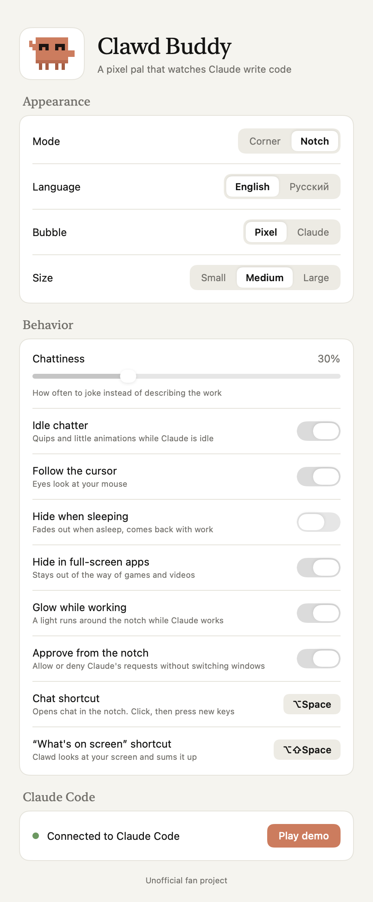

<p align="center"></p>

<h1 align="center">Clawd Buddy</h1>

<p align="center">A tiny pixel crab that lives in the corner of your screen and reacts to what Claude Code is doing.<br>For macOS and Windows.</p>

<p align="center">
  
  
</p>

> Unofficial fan project. Not affiliated with Anthropic.

## What it does

| Claude Code | Clawd |
|---|---|
| You send a prompt | hops, thinks with `?` bubbles |
| Edit / Write | types on a little laptop, `{ } ; </>` fly out |
| Read | reads a document |
| Grep / Glob / Web | scurries around, looking left and right |
| Bash / PowerShell | runs in place; tests, git commit/push, installs and builds get their own lines |
| Tool fails | shakes it off: "Oops… let me fix that" |
| Permission / question / waiting | waves at you until you answer |
| Finished | jumps, confetti |
| 5, 10, 20… edits in one turn | "On a roll! 🔥" |
| An hour of non-stop work | reminds you to take a break |
| Nothing for 2 min | falls asleep and sometimes talks in its sleep |

While idle it looks around, stretches, dances, waves, yawns and wiggles. Its eyes follow your cursor, it smiles when you hover over it, and it flails its legs when you pick it up.

Lines are a mix of what's actually happening and 150+ phrases per language, time-of-day greetings included. English by default, Russian available.

## Windows

1. Download the latest build from **Releases**, or from the newest run under **Actions → Build → ClawdBuddy-windows**:
   - `ClawdBuddy-Setup-x.y.z.exe`: installer
   - `ClawdBuddy-x.y.z-portable.exe`: no install
2. Run it. Settings open on first launch. Click **Connect** to add the hooks to `%USERPROFILE%\.claude\settings.json`.
3. Restart any open Claude Code sessions.

The app is unsigned, so SmartScreen may warn you. Click **More info → Run anyway**.

The Windows version talks to Claude Code through HTTP hooks on `127.0.0.1:47321`, at a URL with a random per-install token so other programs and web pages can't send it fake events. It starts with Windows by default (you can turn that off in Settings). That matters because while the app is closed, Claude Code can't reach it. **Disconnect** in Settings removes the hooks again.

## macOS

Requires macOS 13+, Xcode Command Line Tools (`xcode-select --install`) and `jq` (`brew install jq`) — the installer edits `~/.claude/settings.json` with it.

```bash
git clone https://github.com/pe4enku0/clawd-buddy.git
cd clawd-buddy/macos
./install.sh
```

This builds a native Swift app into `~/Applications/ClawdBuddy.app` and adds async hooks to `~/.claude/settings.json`. Your other settings are kept, and the original file is backed up once as `settings.json.bak-clawdbuddy`. If the app isn't running, the next Claude Code event starts it. `./uninstall.sh` removes the app and its hooks.

## Use

- **Drag** the crab anywhere. The position is remembered.
- **Click** the crab to poke it. Click the bubble to dismiss it.
- **Right-click** the crab, or use the tray / menu bar icon, for **Settings…**, language, demo, hide/show, reset position, quit.

<p align="center"></p>

Settings:
- **Language**: English or Russian.
- **Bubble**: Pixel or Claude style. The Claude style follows light/dark mode.
- **Size**: Small, Medium or Large.
- **Chattiness**: how often it jokes instead of describing the work.
- **Idle chatter**, **follow the cursor**, **hide when sleeping**, and on Windows **start with Windows**.
- **Hook status**, plus a **Play demo** button that runs through every animation.

## Repository

| Folder | |
|---|---|
| `macos/` | native Swift/AppKit + SwiftUI app; `build.sh`, `install.sh`, `uninstall.sh` |
| `windows/` | Electron app: `src/main.js` (window, tray, hook server), `src/hooks.js` (settings.json), `src/renderer/` (sprite, brain, strings, settings page) |
| `.github/workflows/build.yml` | builds the Windows `.exe` and the universal macOS app on every push to `main`; on a `v*` tag it publishes a release |

The two apps share the same sprite, moods and phrases. The JS renderer is a port of the Swift `BuddyView`/`Brain`/`Strings`.

### Windows development

```bash
cd windows
npm install
npm start        # run it (works on macOS too)
npm run dist     # build the installer + portable exe (on Windows)
```

If `npm start` behaves like plain Node inside a VS Code terminal, unset `ELECTRON_RUN_AS_NODE` first.

## License

[MIT](LICENSE). Clawd Buddy is an unofficial fan project and is not affiliated with or endorsed by Anthropic.
